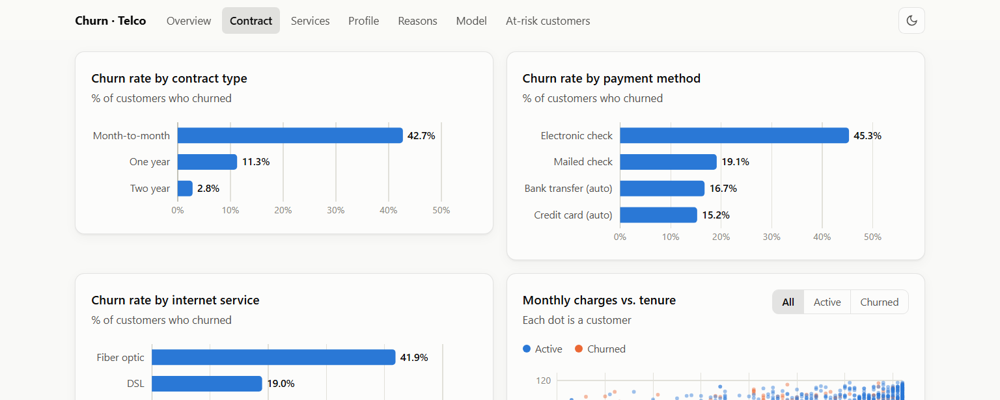

# Customer Churn Analysis — California Telco

Exploratory analysis and predictive model of customer churn for a telecom company in California, built in **R** and presented in an interactive **D3.js** dashboard.

**[Live dashboard →](https://mauricio-alessandrello.com/churn/)**



## The question

About one in four customers (26.5%) left the company. Which customers leave, why, and can we flag the ones at risk before they go?

## Data

The project uses IBM's public **Telco Customer Churn** sample dataset ([available on Kaggle](https://www.kaggle.com/datasets/yeanzc/telco-customer-churn-ibm-dataset)). It covers 7,043 customers of a fictional telecom company in California, with 33 variables: demographics, location, contracted services, billing, churn status, IBM's own churn score, customer lifetime value (CLTV) and the reason given for churning.

## Key findings

- **Contract type is the strongest signal.** 42.7% of month-to-month customers churned, compared with 11.3% on one-year and 2.8% on two-year contracts.
- **Churners are new customers.** Median tenure is 10 months for churned customers and 38 months for active ones. Churners also pay more each month (median $79.65 vs. $64.43).
- **Billing and service matter.** Electronic check payers (45.3%) and fiber optic customers (41.9%) churn the most.
- **Add-on services retain customers.** Among internet customers without tech support, 41.6% churned, versus 15.2% of those with it.
- **Demographics:** seniors (41.7%) and customers without a partner (33.0%) or dependents (32.6%) churn more. Gender makes no difference.
- **Reasons:** competitor-related reasons (better offers, speed, data, devices) explain about a third of churn. "Attitude of support person" is the single most cited reason.

## Predictive model

A logistic regression was trained to estimate each customer's probability of churning.

| Metric (test set, n = 1,760) | Value |
|---|---|
| AUC | 0.864 |
| Sensitivity (churners detected) | 82.7% |
| Specificity | 74.1% |
| Precision | 53.5% |

- **Split:** stratified 75/25 train/test, with 5-fold cross-validation (`caret`).
- **Threshold:** the cut-off is set with Youden's index (0.249) instead of 0.5. This favors catching churners over avoiding false alarms, which suits a retention campaign.
- **Model comparison:** a tuned Random Forest (`ranger`) was benchmarked against the logistic regression and reached a similar AUC (0.861). The logistic regression was kept because its coefficients are easy to interpret.
- **No data leakage:** the company's precomputed churn score, CLTV and churn reason (which only exists for customers who already left) were excluded from the predictors. So were identifiers and fine-grained geography.

Applied to current customers, the model flags **1,413 active customers** above the threshold as candidates for retention.

## Dashboard

The web dashboard (`dashboard/`) is a single scrolling page. All the charts are visible without clicking into tabs. It includes:

- Animated D3 charts with tooltips on hover
- A scatter plot of monthly charges vs. tenure, with an active/churned filter
- The ROC curve with the chosen threshold, and the significant model coefficients explained as odds ratios
- A searchable, paginated table of active customers ranked by churn risk
- Light and dark mode, and a layout that works on mobile

It is plain HTML, CSS and JavaScript with no build step. D3 v7 is loaded from a CDN.

## Repository structure

| File | Description |
|---|---|
| `EDA.R` | Exploratory data analysis and cleaning |
| `Modelo.R` | Model training, comparison (logistic regression vs. Random Forest), evaluation and threshold tuning |
| `exportar_datos_web.R` | Re-runs the model and exports the aggregated data the web dashboard needs to `dashboard/data.js` |
| `dashboard/` | The D3 web dashboard (`index.html`, `app.js`, `data.js`) |
| `reporte_churn.qmd` → `index.html` | Quarto report: exploratory analysis (in Spanish) |
| `reporte_modelo.qmd` → `reporte_modelo.html` | Quarto report: predictive model (in Spanish) |
| `dashboard_churn.qmd` → `dashboard_churn.html` | First version of the dashboard, built with Quarto |
| `data.xlsx` | Source data: IBM Telco Customer Churn dataset (7,043 customers, 33 variables) |
| `modelo_churn.rds` | Saved model from `Modelo.R` |

## Reproduce it

Developed with R 4.4. Install the packages with:

```r
install.packages(c("tidyverse", "readxl", "janitor", "skimr", "broom",
                   "caret", "ranger", "pROC", "jsonlite",
                   "scales", "knitr", "plotly", "DT"))  # the last four are for the Quarto reports
```

From the project root:

```bash
Rscript Modelo.R               # train and compare models
Rscript exportar_datos_web.R   # regenerate dashboard/data.js
```

Then open `dashboard/index.html` in a browser. It also works straight from the file system, without a server.

## Tech stack

**R:** tidyverse, caret, ranger, pROC, Quarto · **Web:** D3.js v7, HTML, CSS, JavaScript

---

Mauricio Alessandrello · [mauricio-alessandrello.com](https://mauricio-alessandrello.com/)
